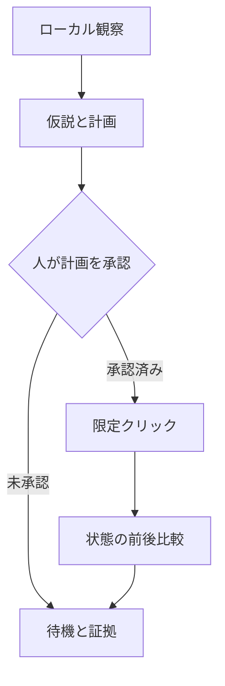

# アーキテクチャと境界

- **ScopeGuard**: `http://127.0.0.1:3000` のリテラル原点のみ。ホスト名・数値変形・認証情報を拒否。全ブラウザリクエストは GET のみ、150件まで。Playwright の `route.continue()` ではリダイレクト先を再傍受できないため、`route.fetch({maxRedirects: 0})` で最初の応答だけを取得し、3xx はブラウザに渡さず中断する。Service Worker と WebSocket を止める。これに加え、OS のネットワーク名前空間はループバックのみでなければ開始しない。
- **Observer**: Playwright で画面と可視ロールのラベルを収集。応答はステータスと有限の MIME/リソース分類のみ。ラベル取得は簡易実装で、完全なアクセシビリティツリーではない。
- **Planner**: 観察済みボタンから1件を選択し、未検証の仮説と計画を生成。オプションの AI 仮説は未信頼データとして扱う。演習の解答集は読み込まない。
- **ApprovalGate**: TTY 上で計画と SHA-256 を表示して手入力確認。計画は最大15分、承認は最大5分。原子的な `wx` ファイル作成で同じ nonce の並行実行・再実行を拒否。保存先を改変できる主体や特権ホスト管理者には対抗しない。
- **Executor**: 承認を消費してから固定の単一ボタンをクリック。要素が0件・複数・不可視なら失敗。タイムアウト時はブラウザを閉じ、承認を再利用できない。
- **Evaluator**: 明示指定された ID のローカル状態を固定パスから最大1 MiB・3秒で取得。自動リダイレクトは行わない。false→true だけを状態遷移として記録し、事前に true のものは成功にしない。
- **Evidence**: JSON と Markdown、UTC 時刻、計画ハッシュ、操作、評価、制限、手順を保存。スクリーンショットの SHA-256 と JSON コンテンツの canonical SHA-256 を計算。暗号署名、本人認証、実施権限の証明ではない。

ブラウザがページ表示のために実行する JavaScript と GET はページ次第で副作用を持ちます。v0.1 の観察は静的なファイル閲覧ではありません。信頼できる使い捨てラボ以外には使わず、他の操作者と同時に変更しないでください。ブラウザ傍受は完全な OS サンドボックスの代わりになりません。コンテナの `network_mode: none` とその確認を外さないでください。

ルートの Worker や双方の共通 v2 スキーマは変更しません。実験用の独自 evidence v1 と既存の v2 は別物で、自動変換・自動送信はありません。
